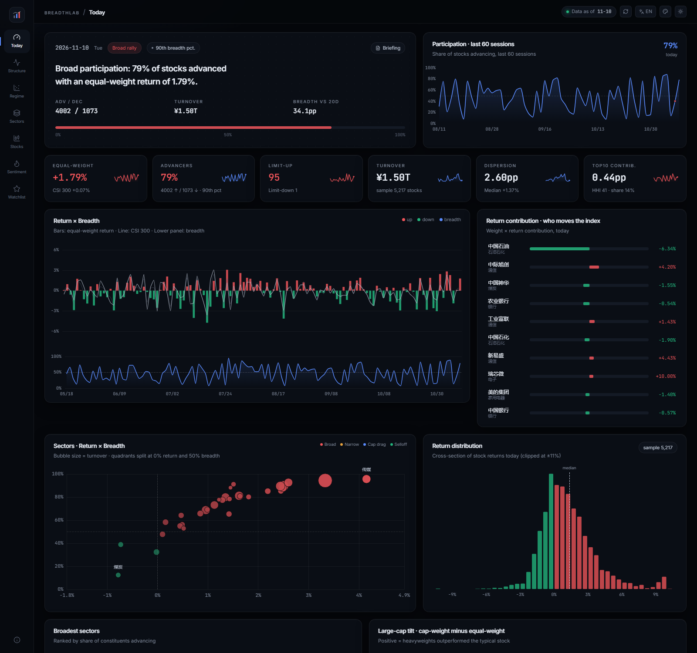

[简体中文](README.md) | **English**

# BreadthLab

A market breadth and structure dashboard for China A-shares. It computes breadth, equal- and cap-weighted returns, concentration, sector participation and dispersion from Tushare daily data, with a web UI, HTTP API and a single-file offline export.

[](https://github.com/Old-Doggy/breadthlab/actions/workflows/ci.yml)
[](LICENSE)
[](https://www.python.org/)
[](https://nodejs.org/)



## Features

- Eight screens covering breadth, concentration, sectors, stocks, sentiment and holdings
- One definition per metric, used by both charts and tables; see [metric_contracts.md](docs/metric_contracts.md)
- Daily incremental load with nine quality gates; failures raise a banner in the UI; falls back to akshare when Tushare is unavailable
- Chinese/English UI, dark/light themes, colorblind palette, URL state, PNG/CSV export
- Single-file HTML build that opens offline

## Quick start

Requirements: Python 3.12, Node 20+, a Tushare Pro token (basic interfaces need 2,000 points).

```bash
git clone https://github.com/Old-Doggy/breadthlab.git
cd breadthlab
conda create -n breadthlab python=3.12 -y
conda activate breadthlab
pip install -r requirements.txt
cp .env.example .env        # set TUSHARE_TOKEN
```

Build the data (pick one):

```bash
# A. Build from the Tushare API, no local snapshot needed
python -m pipeline.bootstrap_api --start 20240101

# B. Use a local parquet snapshot; see docs/data_setup.md
python -m pipeline.bootstrap
```

```bash
python -m pipeline.build_marts
```

Run:

```bash
python -m backend.main      # http://127.0.0.1:8000
```

Single-file build:

```bash
cd frontend && npm install && npm run build && cd ..
python -m pipeline.export_static
# open frontend/dist/BreadthLab.html
```

Daily update:

```bash
python -m pipeline.update_daily
python -m pipeline.build_marts
python -m pipeline.export_static
```

On Windows, `pwsh -File scripts/update.ps1` runs the chain and `scripts/install_task.ps1` registers a 17:35 weekday task.

## Screens

| Screen | Contents |
|---|---|
| Today | Verdict, five KPIs, return × breadth, top contributors |
| Market structure | Return/breadth series, concentration, dispersion |
| Regime | Quadrant scatter, 30-day trail, regime statistics |
| Sectors | Bubbles, cumulative returns, rank migration, rotation |
| Stocks | Cap × return, distribution, table, candlesticks |
| Sentiment | Limit-ups/downs, streaks, highs/lows, seal quality |
| Watchlist | Sector exposure, P&L contribution, positions |
| Method & data | Lineage, quality gates, update log, reconciliation |

## Data

- Primary source: Tushare Pro. Fallback: akshare (free, no token)
- No market data is shipped with the repo; DuckDB and parquet files are built locally
- Sources and fallback rules: [data_sources.md](docs/data_sources.md)
- Snapshot layout: [data_setup.md](docs/data_setup.md)
- Metric definitions: [metric_contracts.md](docs/metric_contracts.md)

## Limitations

- `limit_list_d` requires extra points; the broken-board rate shows `—` without it
- Margin data is published T+1, so the latest session is empty
- Sector membership is static, so historical attribution carries look-ahead bias
- Descriptive analysis only, not investment advice

## Docs

- Data audit: [audit_findings.md](docs/audit_findings.md)
- Design decisions: [decisions.md](docs/decisions.md)
- Screenshots: [docs/screenshots/](docs/screenshots/)

## License

MIT
