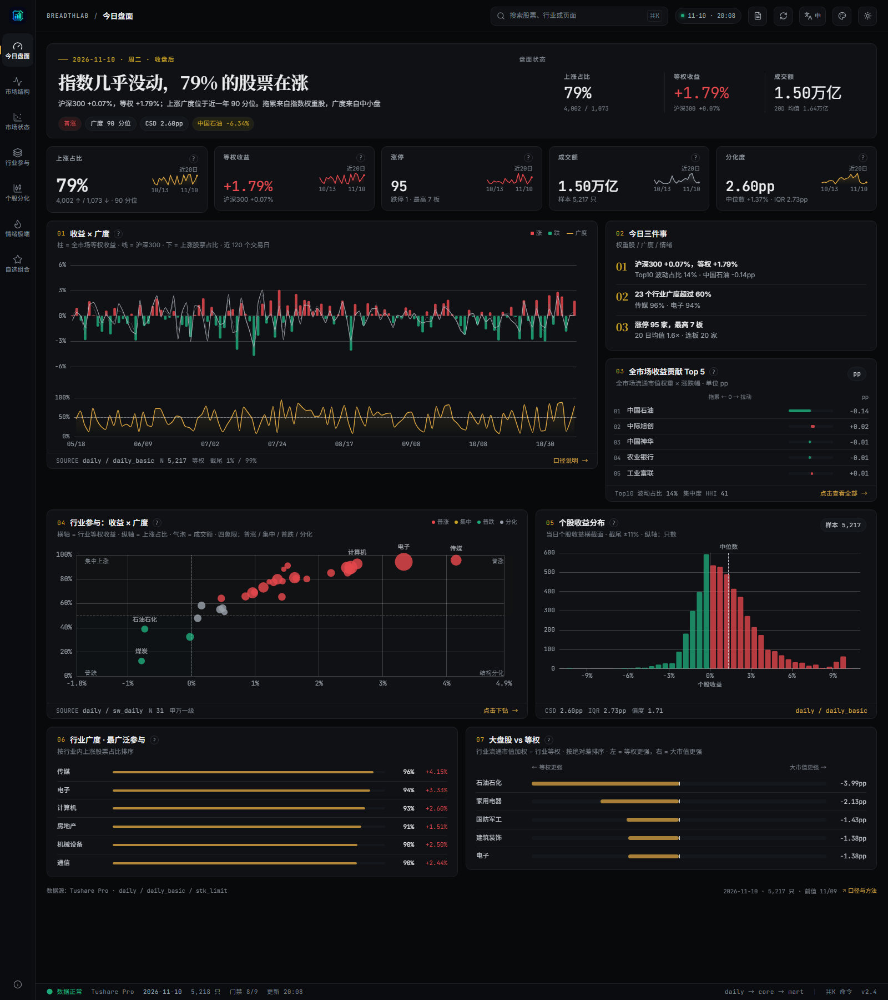
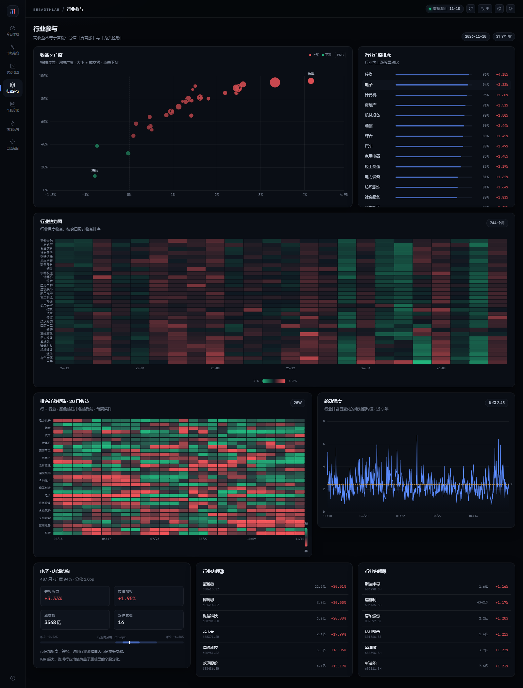
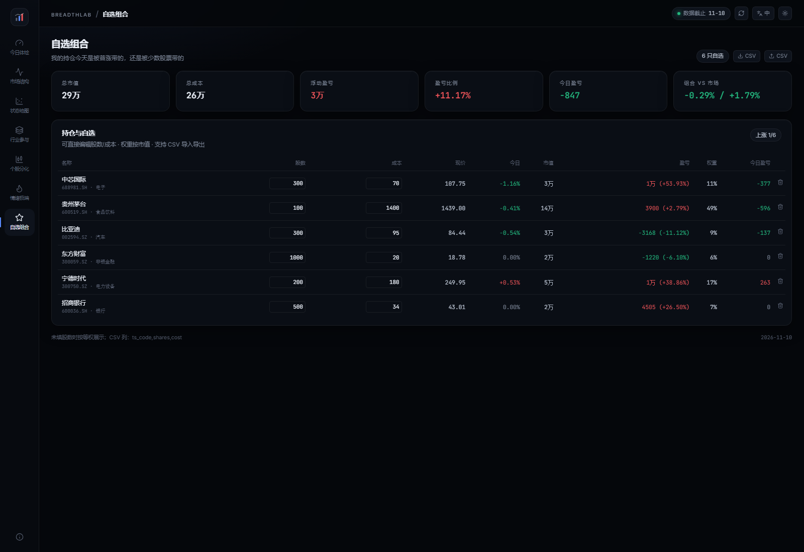

**简体中文** | [English](README.en.md)

# BreadthLab

A 股市场宽度与结构终端。不猜明天涨跌，先把「谁在参与、谁在推动、内部是否一致」看清楚。

[](https://github.com/Old-Doggy/breadthlab/actions/workflows/ci.yml)
[](LICENSE)
[](https://www.python.org/)
[](https://nodejs.org/)



## 它回答什么

指数是加权结果。指数涨 1%，可能 70% 的股票都在涨，也可能只有三只权重股在拉。只盯指数，下面这些问题没有答案：

- 这波行情有多少股票真正参与？
- 涨幅是多数股票贡献，还是少数权重股拉出来的？
- 行业平均收益背后，是普涨还是龙头独舞？
- 涨停、连板、封板质量处在什么位置？
- 自选组合今天是被普涨带起来的，还是被几只股票带的？

BreadthLab 用 8 个页面把这些拆开，指标口径统一，图与数对得上。

## 功能

- **8 个页面**：今日盘面、市场结构、市场状态、行业参与、个股分化、情绪极端、自选组合、方法与数据
- **口径一致**：广度、等权/市值加权、HHI、Top10 贡献与占比、CSD、IQR 全站一套定义
- **交互**：四象限散点、行业气泡、累计收益曲线、排名迁移、K 线、贡献榜下钻
- **双语与主题**：中/英切换、深/浅主题、色盲友好配色（蓝/橙）
- **可分享**：URL 状态（`?range=1Y`、`?sector=电子`）、图表 PNG、表格 CSV
- **单文件导出**：JS/CSS/字体/数据全部内联，双击即可离线打开
- **每日更新**：增量抓取 → 9 条质量门禁 → core → mart → 导出；失败不会发布半成品
- **备用数据源**：Tushare 故障时，`daily/daily_basic/stk_limit/adj_factor` 自动降级到 akshare

## 页面

| 页面 | 回答的问题 | 核心内容 |
|---|---|---|
| **今日盘面** | 今天是什么性质的一天？ | 结论句 + 5 个 KPI + 收益×广度 + 贡献 Top5 |
| **市场结构** | 收益与广度长期如何背离？ | 收益/广度序列 + 集中度 + 分化度 |
| **市场状态** | 今天落在收益×广度的哪个位置？ | 四象限散点 + 30 日轨迹 + 状态统计 |
| **行业参与** | 哪个行业是真普涨，哪个只是龙头拉？ | 气泡 + 累计收益曲线 + 排名迁移 + 轮动强度 |
| **个股分化** | 行业均值之下个股长什么样？ | 市值×收益散点 + 分布 + 明细表 + 个股详情 |
| **情绪极端** | 涨停、连板和新高低处于什么位置？ | 涨跌停 + 连板梯队 + 新高新低 + 两融 |
| **自选组合** | 我的组合被什么带动？ | 行业暴露 + 盈亏贡献 + 可编辑股数/成本 |
| **方法与数据** | 数据可信吗？口径是什么？ | 血缘 + 质量门禁 + 更新日志 + 源间对账 |

| 行业参与 | 自选组合 |
|---|---|
|  |  |

更多截图在 [`docs/screenshots/`](docs/screenshots/)，含英文界面、色盲模式、移动端。

## 快速开始

### 0. 准备

- Python **3.12**（推荐 conda）
- Node **20+**（只改前端时需要）
- **Tushare Pro token**：免费注册即可，`daily` 等基础接口需要 2000 积分
- 操作系统：Windows / macOS / Linux 都能跑；定时任务与简报脚本目前偏 Windows

### 1. 安装

```bash
git clone https://github.com/Old-Doggy/breadthlab.git
cd breadthlab
conda create -n breadthlab python=3.12 -y
conda activate breadthlab
pip install -r requirements.txt
cp .env.example .env        # Windows: copy .env.example .env
```

编辑 `.env`：

```ini
TUSHARE_TOKEN=你的token
# 可选：本地 parquet 快照目录（没有就用 Tushare API）
# BREADTHLAB_SOURCE=./data/snapshot
```

### 2. 构建数据

**方式 A：Tushare API（没有本地快照时）**

```bash
python -m pipeline.bootstrap_api --start 20240101
```

每个交易日 7 个接口调用，历史越长耗时越久（约 1–2 秒/日）。`limit_list_d` 需要额外积分，无权限会自动跳过并记录 warning。

**方式 B：本地 parquet 快照（更快，可全量历史）**

按 [`docs/data_setup.md`](docs/data_setup.md) 的目录结构准备好 Tushare parquet 导出，然后：

```bash
python -m pipeline.bootstrap
```

两种方式完成后都执行：

```bash
python -m pipeline.build_marts
```

### 3. 运行

本地 API：

```bash
python -m backend.main          # http://127.0.0.1:8000
```

导出单文件：

```bash
cd frontend
npm install
npm run build
cd ..
python -m pipeline.export_static
# 双击 frontend/dist/BreadthLab.html
```

前端开发：

```bash
cd frontend
npm run dev                     # http://localhost:5173
```

### 4. 每日更新

```bash
python -m pipeline.update_daily
python -m pipeline.build_marts
python -m pipeline.export_static
```

Windows 可以直接用 `pwsh -File scripts/update.ps1`，并用 `scripts/install_task.ps1` 注册工作日 17:35 的计划任务；macOS/Linux 用 cron 调同样的三个命令。

## 数据与口径

### 数据源

- **主源**：Tushare Pro（`daily`、`daily_basic`、`adj_factor`、`stk_limit`、`limit_list_d`、`moneyflow`、`margin`、`index_daily`）
- **备用源**：akshare / 东方财富，免费、无需 token；`daily`、`daily_basic`、`stk_limit`、`adj_factor` 当日自动降级
- **不随仓库分发数据**：DuckDB、parquet、token 都不在 Git 里，需要按上面的步骤自己构建

### 关键口径

| 指标 | 定义 |
|---|---|
| 上涨占比 `breadth` | N(涨) / (N(涨)+N(跌))，平盘剔除 |
| 等权收益 `ew_ret` | mean(pct_chg / 100) |
| 市值加权 `cw_ret` | Σ wᵢrᵢ，权重用**前一日**流通市值归一 |
| 集中度 `hhi` | Σ wᵢ² × 10000 |
| Top10 贡献 | Σ_{Top10} wᵢrᵢ × 100（pp） |
| Top10 波动占比 | Σ_{Top10} \|wᵢrᵢ\| / Σ\|wᵢrᵢ\|，0–1 |
| 分化度 `csd` | 横截面收益标准差（pp） |
| 涨停 | `close ≥ up_limit × 0.999`，用 `stk_limit` 的真实涨跌停价 |
| 新高 | `adj_close ≥ 过去 252 日最高`，且历史 ≥ 250 日 |
| 行业 | Tushare 行业 → 31 个申万一级，覆盖 99.9% |

行业映射是已知最脏的一环：`index_member_all` 本地为空，`bak_basic.industry` 会漂移。当前用「静态标签 + 人工桥接表」，未映射股票计入“未分类”，页面会标注。

## 工程结构

```
breadthlab/
├─ pipeline/       # bootstrap / bootstrap_api / build_marts / update_daily / export_static / quality_gates
├─ backend/        # Flask API
├─ frontend/       # Vite + React + TypeScript + Tailwind + ECharts
├─ config/         # industry_bridge.csv、universe.yaml、data_source_registry.yaml
├─ scripts/        # update.ps1 / dev.ps1 / briefing.ps1 / install_task.ps1
├─ tests/          # 指标 golden values、API 契约、锁与备用源
└─ docs/           # 口径、审计、数据源、截图
```

技术栈：DuckDB（本地列存，聚合快）+ Flask（同步、依赖少）+ React/ECharts（交互与视觉）+ 单文件导出（离线可看）。

## 已知限制

- `limit_list_d` 需要额外积分；无权限时炸板率显示 `—`，连板高度改用价格判定
- 两融 T+1 发布，最新一个交易日显示 `—`
- 北向资金 2024-08-19 后口径断裂，不做跨期序列
- 行业分类为静态映射，历史行业归属存在前视偏差
- 全部为**描述性分析**，不构成预测或投资建议

## Roadmap

- [x] 每日简报 PDF/PNG
- [x] 自选持仓盈亏、行业轮动、K 线、PE 分位
- [x] 9 条质量门禁 + 更新日志 + 源间对账
- [x] 色盲模式、URL 状态、PNG/CSV 导出
- [ ] 行业映射升级为申万 PIT 成员
- [ ] Brinson 简化归因
- [ ] 更新失败告警（桌面 / SMTP）

## License

MIT © 2026 BreadthLab contributors
